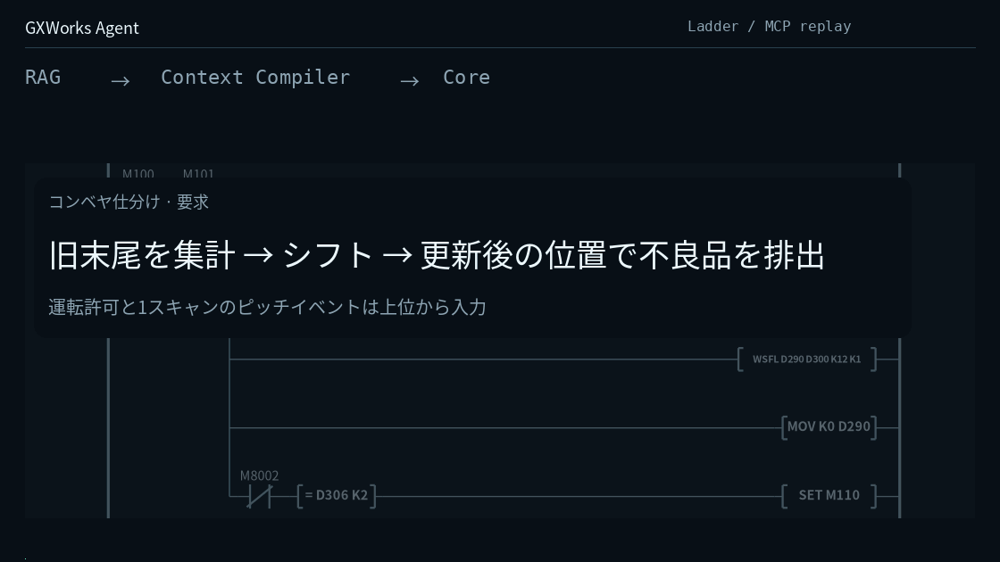
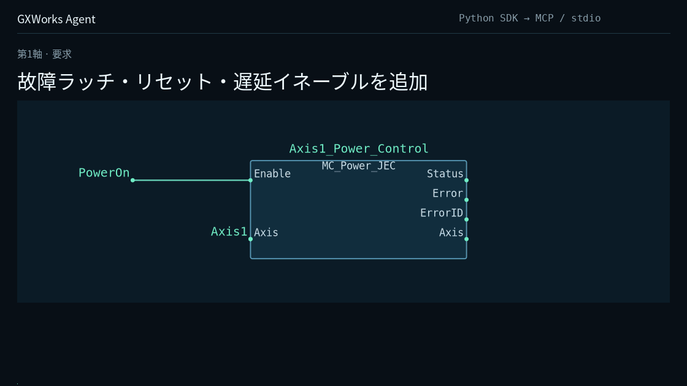
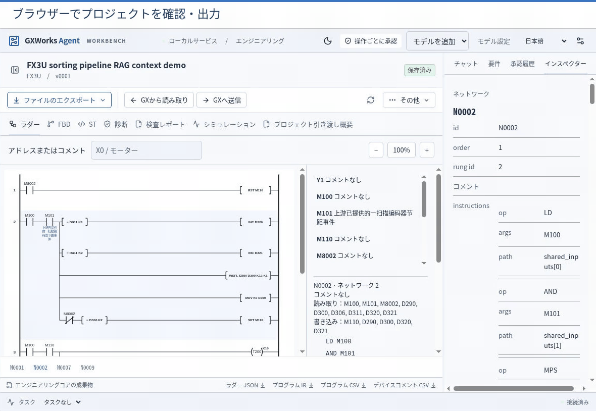

<h1 align="center">GXWorks Agent</h1>

<p align="center"><strong>原作者: <a href="https://github.com/Arienax">Arienax</a></strong> · <a href="https://github.com/Arienax/gxworks-agent">github.com/Arienax/gxworks-agent</a></p>

<p align="center">© 2026 Arienax · Apache-2.0</p>

<h3 align="center">三菱電機 PLC エンジニアリング向け MCP ツールサービスと AI ワークベンチ</h3>

<p align="center"><strong>設計コンテキストの取得 · プログラムの生成とレビュー · GX Works2 ネイティブ編集と診断</strong></p>

<p align="center">
  <a href="https://github.com/Arienax/gxworks-agent/releases/latest"></a>
  <a href="#mcp"></a>
  <a href="#quick-start"></a>
  <a href="LICENSE"></a>
</p>

<p align="center"><strong><a href="https://github.com/Arienax/gxworks-agent/releases/latest">ダウンロード</a> · <a href="#mcp">MCP と Web</a> · <a href="https://github.com/Arienax/gxworks-agent/issues">問題の報告</a></strong></p>

<p align="center"><a href="#quick-start">クイックスタート</a> · <a href="#offline-gxw">GXW オフライン編集</a> · <a href="#ladder">ラダー</a> · <a href="#st">ST</a> · <a href="#fbd">FBD</a> · <a href="#native-session">ネイティブセッション</a> · <a href="#web">Web ワークベンチ</a> · <a href="#diagnostics">診断・検証</a></p>

<p align="center"><a href="README.zh-CN.md">简体中文</a> · <a href="README.md">English</a> · <strong>日本語</strong></p>

GXWorks Agent は、三菱電機 PLC のプロジェクト情報、CPU ごとに整理された命令知識、決定論的な静的検査、そして GX Works2 のネイティブ操作を統合したエンジニアリングツールチェーンです。**ラダー（Ladder）**、**構造化テキスト（ST）**、**ファンクションブロックダイアグラム（FBD）**のワークフローに加え、既存の **SFC** プロジェクトの編集・診断に対応しています。

Codex、Claude Desktop、Cursor などの MCP クライアントを接続すれば、クライアント側のモデルを使ってエンジニアリングツールを呼び出し、プログラムの生成、継続的なネイティブ編集、検証、成果物のバージョン保存までを一貫して行えます。MCP サーバーは単独で動作し、必要に応じて **Web ワークベンチ**を併用すれば、ブラウザー上での Direct 生成、視覚的な差分レビュー、シミュレーション、承認に基づく GX Works2 への受け渡しも利用できます。

<a name="offline-gxw"></a>

## 既存 GXW ファイルのオフライン読み取りと編集

対応形式の `.gxw` は、GX Works2 のインストールや起動なしに読み取り、編集、保存できます。

1. **Web**：メイン会話に `.gxw` をドロップするか、**GXW をインポート**からファイルを選択します。Agent プロジェクトの事前作成は不要です。通常の Program が 1 つなら検査後に自動選択され、複数ある場合は対象を選びます。既存 FB または FUNCTION も明示的に選択できます。
2. **MCP**：`inspect_gxw_project` でファイルの CPU、プログラム一覧、形式ごとの対応能力を確認し、`import_gxw_project` で共通のプロジェクト・バージョン管理フローに取り込みます。
3. 変更要求を入力し、プレビューと差分を確認して新しいバージョンに保存します。`program.gxw` をダウンロードし、再インポートして編集を続けられます。元の入力ファイルは保持されます。

既存ラダーをインポートすると、接点、コイル、分岐を自動表示します。出力後の条件や `MPS/MRD/MPP` も元の順序を保ち、命令一覧も確認できます。

4 言語は共通のオフライントランザクションを使用します。ラダーでは元の命令に結び付けて命令、浮動小数点、文字列、P/I ラベルを編集・移動し、`MPS/MRD/MPP` の順序と未変更レコードのバイト列を保持します。ST は既存 Program、FB、FUNCTION の本文と宣言、既存インターフェース、引数順序、戻り値型を編集し、呼出元も検査します。FBD はオブジェクト、接続、ネットワーク、変数、既存 FB 定義のインスタンスを編集できます。既存 SFC はステップ、移行条件、アクション、分岐、合流、ジャンプ、子プログラムを編集し、内部登録を維持します。宣言行の追加・削除・並べ替えと、実際の QCD コメントの全文保存に対応します。

インポート後は「編集対象のプログラム」で同じファイル内の別ソースを選べます。MCP の `read_gxw_source` は編集モデルを返し、`edit_gxw_project` は現在の `version_id` に対して複数のソース・宣言・コメントをまとめて編集し、ソースごとの差分を表示します。既定の `save_policy="draft"` では、ファイル構造と格納参照を検証したうえで診断付きの編集途中の版を保存でき、`checked` を指定すると新たに生じた既知のエラーを拒否します。

FX/Q/L のモデル一覧全体をファイル能力の判断に使用し、CPU、形式、オブジェクト、操作ごとに対応範囲を返します。未知レコードのバイト列を保持したまま解析済みオブジェクトの編集を行え、未解決の依存関係がある変更には対象と理由を返します。この経路は既存のソースオブジェクト、宣言、コメントのオフライン編集を対象としています。

ソースや宣言を変更すると以前のコンパイル結果は期限切れ（`stale`）として扱われ、コンパイラーによる検証が必要な場合は明示的にネイティブコンパイル検査を実行します。

`validate_project(native=true)` は分離したコピーをコンパイルして検査します。`compilation.acceptance=accepted` は、そのコピーをコンパイラが受理したことを示します。コンパイル成果物は書き戻さず、`save.completed` と `save.exported` はともに `false` のため、ダウンロードした工程が GX Works2 で未コンパイルと表示される場合があります。公開ツール `compile_project` もローカル Core コンパイルのみを行います。ネイティブのコンパイル成果物を保存するには、GX Works2 でコンパイルして保存するか、独立したワークスペース API `NativeWorkspaceSourceSave.compile_project` を使用し、保存とコールド再オープンの結果を確認してください。コンパイル、コード検査、保存、PLC 実行の結果は独立しています。

<a name="ladder"></a>

## ラダー：設計コンテキストの取得から成果物の保存まで



FX3U のコンベヤ制御を例に、対象 CPU における `WSFL`、`INC`、`T200` の命令知識とマニュアル根拠を取得し、ラダー候補を構築して MCP 経由で保存します。Python Core が構造・オペランド検査、共通条件の整理、保守性チェックを実行し、ラダー JSON、PLC IR、SVG 図、IR から変換した追跡可能な ST、GX Works2 インポート用 CSV（MAIN・デバイスコメント）を出力します。保存済みバージョンに対する部分修正には、`read_network` と `patch_program` によるネットワーク単位のパッチ適用も使えます。

GIF は、外部クライアントが MCP の返したコンテキストから候補プログラムを構築し、検証を経て成果物を保存するまでの一連の流れを示しています。

<a name="st"></a>

## ST：構造化テキストの生成とネイティブプロジェクト編集

ST ワークフローは、単体テキストの生成と `.gxw` ネイティブプロジェクトの保守の両面に対応しています。

- **Web での単体生成とレビュー**：ワークベンチで要求分析と仕様確認を行い、選択した CPU の命令コンテキストと ST シグネチャをもとに `program.st` を生成します。候補のプレビュー、バージョン間のテキスト差分確認、ST 成果物の保存が可能で、ラダーの PLC IR から追跡可能な ST を出力することもできます。
- **GXW ST プロジェクト編集**：`read_st_project` は既存 Program、FB、FUNCTION の本文、宣言、所属を読み取り、`create_st_candidate` は既存本文と宣言をオフライン編集します。通常 ST Program の新規作成は、明示したリソース・タスクとネイティブ操作の経路を引き続き使用します。継続ネイティブセッションでは FBD と連携した編集・コンパイルを別途行えます。

ローカルの ST 検査器は対応範囲の構文・意味を素早く検証して確認が必要な記述を明示し、GX Works2 のネイティブコンパイルと組み合わせて段階的に検証を進められます。

<a name="fbd"></a>

## FBD：CPU 別空白テンプレートから既存 GXW の高度な編集まで



上の例では、三菱電機の [MotionControl JEC サンプル](https://eu-assets.contentstack.com/v3/assets/blt5412ff9af9aef77f/blt9206f69c182f67c3/634ea5238602a36d8e991e63/MotionControl_JEC_a.zip)の第 1 軸に、異常ラッチ保持、リセット、500 ms のイネーブル遅延を追加しています。既存の FB 実装や Axis の `IN_OUT` 接続を維持したまま SR/TON ロジックを組み込み、動作許可信号を既存のパワー制御ブロックへ接続します。

デモの配線変更にとどまらず、FBD モジュールはプロジェクト構築から保守までを幅広くカバーします。

- **テンプレートからの新規作成・既存 GXW のインポート**：CPU 別の空白 FBD テンプレートを 57 種類同梱しており、対象機種を選んで新規プロジェクトを始めることも、既存の `.gxw` をインポートして編集を続けることもできます。
- **パラメーター単位と図形単位の 2 つの編集モード**：`get_fbd_catalog` が返すパラメータースキーマに沿って `calls` と `arguments` を送信し、Core に端子展開・`IN_OUT` ペアリング・配線を任せることも、ノード・端子・直交ワイヤ・複数ネットワークを明示的に追加・変更・削除することも可能です。
- **定義作成・ユーザーライブラリ取込・タスク登録**：構造体、ST/FBD ファンクションブロック、グローバル／ローカル宣言テーブルの読み書きに対応しています。呼び出し側プログラムを保持したまま別プロジェクトの `.gxw` からユーザーライブラリ定義を取り込む機能（`read_fbd_libraries` / `import_library`）や、ソースプロジェクトが対応する範囲での FB・Program の新規作成、既存／新規タスク・リソースへの登録、システムデバイス割付範囲の設定も行えます。
- **成果物と各種検証の分離**：保存ごとに `program.gxw`、`fbd.json`、`fbd.svg`、書き込み検証レポートを生成します。ローカル読み戻し検証、ネイティブ保存、単体コンパイル、コードチェックは個別の操作として扱われ、結果が各バージョンに紐づきます。

<a name="native-session"></a>

## 継続する GX Works2 ネイティブエンジニアリングセッション

`execute_native_engineering(mode="live")` を使うと、MCP クライアントは**起動し続ける 1 つの GX Works2 プロセス**に対して複数回のツール呼び出しにまたがる段階的な編集を行えます。操作のたびにファイルを保存して開き直す必要はありません。

- **同一セッションでの段階的な構築**：グローバル／ローカルラベル表の編集、通常 ST Program や ST FB の作成・更新、FBD 呼び出しの挿入、さらに現在の文書上のノード・端子 ID に紐づく端子再バインド、ノード移動、ワイヤ引き直しを同じセッション内で連続して進められます。
- **その場でのコンパイルとスコープ別アドレス照会**：編集中のソースをコンパイル（`compile`）し、ネイティブのクロスリファレンスを通じてグローバル宣言、Program ローカル変数、`インスタンス.メンバー` の割付アドレス（`show_assignments`）を確認できます。ソースを再変更すると、以前のコンパイル結果とアドレスは自動的に `stale`（無効）として扱われます。
- **ステップ制御と中断からの安全な再開**：ステップごとの待機時間（`dwell_ms`）、1 ステップ実行（`step_mode`）、一時停止（`pause_native_engineering_session`）と再開に対応しています。アクティブな編集（`revision`）、ディスク保存（`saved_revision`）、確定したアプリバージョン（`version_revision`）は個別に追跡され、タイムアウトや中断が起きた操作は `unconfirmed` として保持し、`rebind` で実際の画面状態を読み取って照合してから再開します。

ネイティブエンジニアリングセッションには、対話操作が可能な Windows デスクトップ、GX Works2 `1.635.0.1`、および操作員が設定した実行許可が必要です。

<a name="web"></a>

## Web ワークベンチ：Direct 生成、視覚的レビュー、エクスポート



ワークベンチでモデル API を設定すると、内蔵の **Direct 生成フロー**で要求分析、仕様確認、プログラム生成を実行し、ラダーのネットワーク、FBD/SFC のグラフ、デバイス使用状況、バージョン間差分、エクスポート可能な成果物をブラウザー上で確認できます。Direct は MCP と同じ設計コンテキスト・RAG パイプラインを共有しつつ外部エージェントのオーケストレーション負荷を抑えます。ワークベンチ内の質疑応答でも必要に応じて読み取り専用ツールが呼び出されます。

現場仕様の補足が必要な場合は、質問ごとに独立した入力欄が表示され、パネルの切り替えや再読み込みを行っても入力途中の内容が保持されます。生成時は接続先が対応していれば厳密な構造化出力を使用し、曖昧さのない形式差をローカルで正規化してから Core の検証に進みます。

## ツールチェーンとアーキテクチャの役割分担

- **プロジェクトコンテキストと稼働中セッションの検出**：CPU とプログラム形式を指定してバージョン管理されたプロジェクトを作成・選択できるほか、Agent プロジェクトを作らずに `list_gxworks2_sessions` と `read_gxworks2_snapshot` を呼び出し、現在開いている GX Works2 ウィンドウから読み取り専用スナップショットを取得してネットワーク単位で解析できます。GX Works2 を開いていない場合も、`inspect_gxworks2_csv_files` にプログラム CSV、デバイスコメント CSV、明示的な CPU を渡すと同種の読み取り専用 `source_ref` を取得できます。
- **CPU スコープの設計 RAG**：エンティティ検索、全文検索、dense/LSA ベクトル検索を組み合わせて順位を統合します。既知の命令には構造化知識から正確なオペランド・ステップ数・修飾ルールを渡し、追加検索でマニュアル根拠とプロジェクト独自の事例を重複なく補います。
- **決定論的な Core 検証とバージョン成果物**：Python Core が PLC ドメインの意味論を保持し、IR 構築、オペランド・タイミング検査、FBD トポロジー・宣言照合、バージョン成果物の生成を担い、ネイティブコンパイルやシミュレーション、実機モニターと連携します。
- **承認に基づく GX Works2 への受け渡し**：操作員が設定した承認ポリシーのもとで、現在のラダーバージョンの MAIN とデバイスコメントのインポートや、FBD/ST のネイティブ保存・コンパイル・セッション操作を実行し、バージョンに紐づく実行結果を返します。

モデル推論と計画ループはクライアントまたはハーネスが担い、GXWorks Agent は設計コンテキスト、決定論的ツール、バージョン保存、操作結果を提供します。

<a name="diagnostics"></a>

## プロジェクト管理・診断・シミュレーション

| 機能モジュール | できること |
| --- | --- |
| プロジェクト・バージョン管理 | CPU とプログラム形式（Ladder / ST / FBD / SFC）を指定した作成・選択、要求と確認済み仕様の管理、候補レビュー、バージョン比較、成果物のエクスポート。 |
| 起動中 GX の読み取りスナップショット | PC 上で開いている GX Works2 セッションを検出し、Agent プロジェクトを作らずに一時的な読み取り専用スナップショット（`source_ref`）を取得してネットワーク読み取りや静的検査を実行。 |
| ネイティブコンパイルとソース位置診断 | 隔離ワークスペースで保存済み `.gxw` をコンパイル・コードチェックし、宣言や FB インスタンスメンバーの割付アドレス照会（`read_native_device_assignments`）、保存済みコードチャネルと再コンパイル結果の比較（`compare_native_compiled_code`）、診断やステップ番号（`locate_native_code_steps`）から ST の行・宣言・FBD ネットワーク／ノード・呼び出しインスタンスへの対応付けを実行。一意に特定できない箇所は `unresolved` として保持。 |
| 既存 SFC プロジェクトの編集 | ソース関係図をオフラインで読み取り、ステップ、移行条件、アクション、分岐、合流、ジャンプ、子プログラムを編集。内部オブジェクト、宣言、登録を同時に追加・削除し、差分確認とバージョン保存を行います。 |
| ラダーシミュレーションと波形タイムライン | バージョンに紐づくテスト計画・デバイス入力・期待結果を実行するほか、`connect_simulator` と `start_simulator_trace` で接続中の GX Simulator2 から型付き信号を読み取り専用でサンプリングし、同梱の Web タイムラインビューアー（`simulator.html`）で波形を確認。 |
| PLC 読み取り専用モニター | 操作員の承認に基づき、設定済みの MX Component 論理局から指定デバイスを読み取り専用で取得し、現在値と履歴を確認。権限はプロジェクトバージョン、アドレス範囲、有効期限に紐づき、いつでも取り消し可能です。 |

<a name="quick-start"></a>

## クイックスタート

Windows 10/11 x64 で[リリースページ](https://github.com/Arienax/gxworks-agent/releases/latest)から必要なパッケージを取得し、ZIP 全体を展開してください。どちらのパッケージも単独で動作し、Python や Node.js のインストールは不要です。

| パッケージ | 主な用途 | 起動入口 |
| --- | --- | --- |
| `GXWorks-Agent-MCP-windows-x64.zip` | Codex、Claude Desktop、Cursor などの MCP クライアントに接続し、クライアントのモデルを使用 | `gxworks-agent-mcp.exe --local` |
| `GXWorks-Agent-Full-windows-x64.zip` | Web ワークベンチと MCP を同梱し、実行リソースを共有 | `start-web.cmd` / `gxworks-agent-mcp.exe --local` |

スリム版の `MCP` パッケージは Web サーバー、モデル SDK、オフライン PDF 取り込み用依存関係、デモアニメーションを省いて軽量化しつつ、エンジニアリングツール、RAG 検索、テンプレート、ネイティブ補助プログラム、シミュレータータイムライン表示をすべて保持しています。`Full` パッケージは両方の起動入口を含み、同梱の MCP は `--local` で単独動作するほか、`--service` で起動中の Web ワークベンチに接続してプロジェクトとレビューフローを共有できます。

<a name="mcp"></a>

### 単独動作の MCP モード

クライアントに stdio サーバーを追加し、コマンドに展開先の `gxworks-agent-mcp.exe` のフルパス、引数に `--local` を指定します。接続を更新したら、`list_projects` で既存プロジェクトを選択するか実際の CPU とプログラム形式を指定して新規作成します。保存済みファイルには [GXW オフラインインポート](#offline-gxw)を使用できます。すでに開いている GX Works2 ウィンドウを調べる場合は `list_gxworks2_sessions` から始められます。

まずは次のような依頼から試せます。

> 「FX3U のラダープロジェクトを作成し、まず生成コンテキストと関連命令の根拠資料を取得してください。X0 が押されるたびに 1 回カウントし、3 回で Y0 を ON、X1 でリセットするプログラムを作成して候補を保存し、生成された成果物と残っている診断を示してください。」

外部クライアント自身のモデルを使うため、Web の起動は不要です。GX へのインポートやネイティブ操作は設定済みの実行許可に従います。視覚的なレビューやプロジェクト共有が必要な場合は Web ワークベンチを併用できます。

**同梱の MCP ルーター Skill**：ソースリポジトリと両リリースパッケージの [`skills/gxworks-mcp-router/`](skills/gxworks-mcp-router)（`SKILL.md` と `references/`）には、主要な PLC エンジニアリング作業に向けた MCP ツールの選び方、主要パラメーター、呼び出し順序をまとめた Agent Skill が同梱されています。読み取り専用スナップショットとバージョン編集、オフライン `.gxw` 編集と継続ネイティブセッション、ローカル成果物生成とバックグラウンドでのネイティブコンパイル検査、および `local` / `service` / `context` 各モードの応答処理をカバーしています。MCP 接続後、`gxworks-mcp-router/` ディレクトリ全体をクライアントのスキルフォルダーにコピーして有効化できます。

### Web ワークベンチモード

展開した `Full` ディレクトリ内の `start-web.cmd` を実行し、エンジニアリングワークスペース用のフォルダーを選択します。新しいプログラム用にプロジェクトを作成するか、[既存 GXW をインポート](#offline-gxw)します。AI による生成・変更には **Settings → Model → Model API** でモデルサービスを設定します。既存プロジェクトの閲覧、ファイルやグラフの確認、成果物のエクスポートにはモデル呼び出しは不要です。アップデート時は新しいディレクトリへ展開すれば、別保存のワークスペースと個人設定がそのまま引き継がれます。

### ソースから実行

Python 3.13 と Node.js 22.14 以降をインストールし、次を実行します。

```powershell
git clone https://github.com/Arienax/gxworks-agent.git
cd gxworks-agent
.\build-web.bat --no-pause
.\start-web.cmd
```

ソースから MCP のみを利用する場合は、`.venv-mcp` を作成して `requirements/mcp.txt` をインストールし、`gxworks-agent-mcp.cmd --local` で起動します。この場合 Node.js は不要です。

### エンジニアリングテンプレートと知識リソース

パッケージの `gxw/templates/`（ソースでは `src/gxw/templates/`）には、FX3U の基準プロジェクト、ノード・トークン定義、および CPU 別の空白 FBD プロジェクト 57 個が含まれています。アプリケーションをコピー・移動する際はこれらを保持してください。

実行パッケージには RAG 用に整理された事実コーパスとプロジェクト独自の事例を同梱しており、三菱電機の原本マニュアル PDF や原文インデックスは含まれません。ランタイム知識データはソースリポジトリとは別に配布されます。ソースから実行する場合は、リリースパッケージ内の `knowledge/` を `resources/knowledge/` に、`resources/instructions/mitsubishi/` をソースの同名ディレクトリにコピーして利用できます。

オフラインでの GXW ファイル操作に三菱電機ソフトウェアのインストールは不要です。ネイティブ保存、ネイティブコンパイル・コードチェック、GX Works2 への受け渡し、ネイティブシミュレーションには対応する三菱電機ソフトウェアがローカル環境に必要です。PLC の読み取り専用モニターには MX Component と論理局の設定が必要です。これらの三菱電機ソフトウェアはパッケージに同梱されていません。

Windows のネイティブアダプターは x86 プロセスで GX Works2 のコンポーネントを読み込みます。Python ホストは 64 ビットでも使用できます。pywinauto のビット数に関する警告だけでは操作失敗と判断せず、実際のエラーを確認してください。スクリーンショットを取得できない場合も元の例外を保持し、画面取得の問題を別に報告します。

## 設備の試運転前に

試運転前に、生成されたロジックを対象 CPU、実配線、機構の動作範囲、運転モードに照らして確認してください。インポート前に対象の GX プロジェクトをバックアップし、GX Works2 へプロジェクト更新を送信したあと、GX Works2 上でコンパイル・チェックおよび実機への書き込みを行ってください。

非常停止、安全インターロック、オーバートラベル保護などの安全機能は、独立したハードウェア安全回路・安全システムで構成してください。診断記録を共有する際は機密情報を除去し、API 認証情報やローカルセッションの URL は非公開に保ってください。

## 資料とライセンス

[リリースの変更点](CHANGELOG.md) · [Issue](https://github.com/Arienax/gxworks-agent/issues)

プロジェクト貢献者が権利を持つ Core、Web、MCP、ネイティブアダプターのソースコードには [Apache License 2.0](LICENSE) を適用します。詳細は[ライセンス範囲](LICENSING.md)と[第三者の権利表記](THIRD_PARTY_NOTICES.md)を参照してください。各貢献者は自身の著作権を保持し、過去に配布されたリリースにはそれぞれの配布時点のライセンスが適用されます。[NOTICE](NOTICE) にオリジナルプロジェクト、作者、リポジトリを記録しています。
