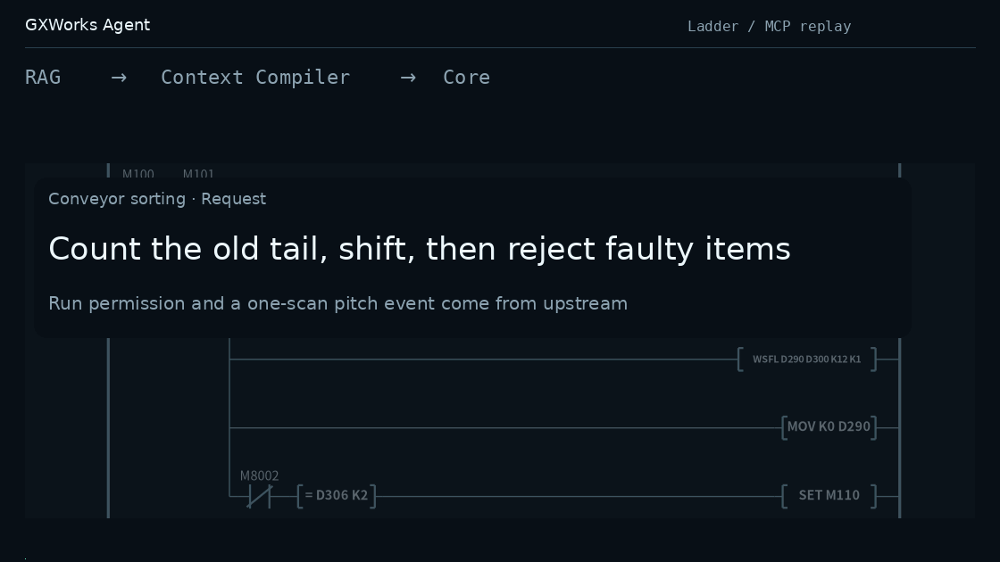
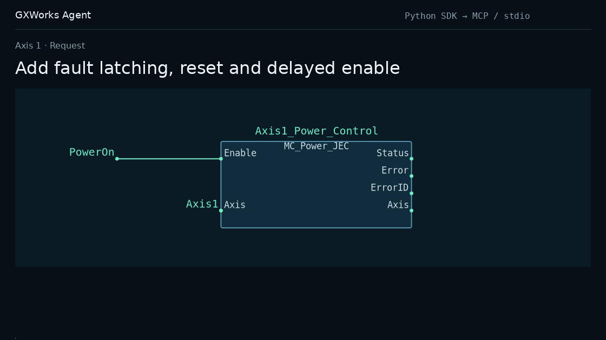
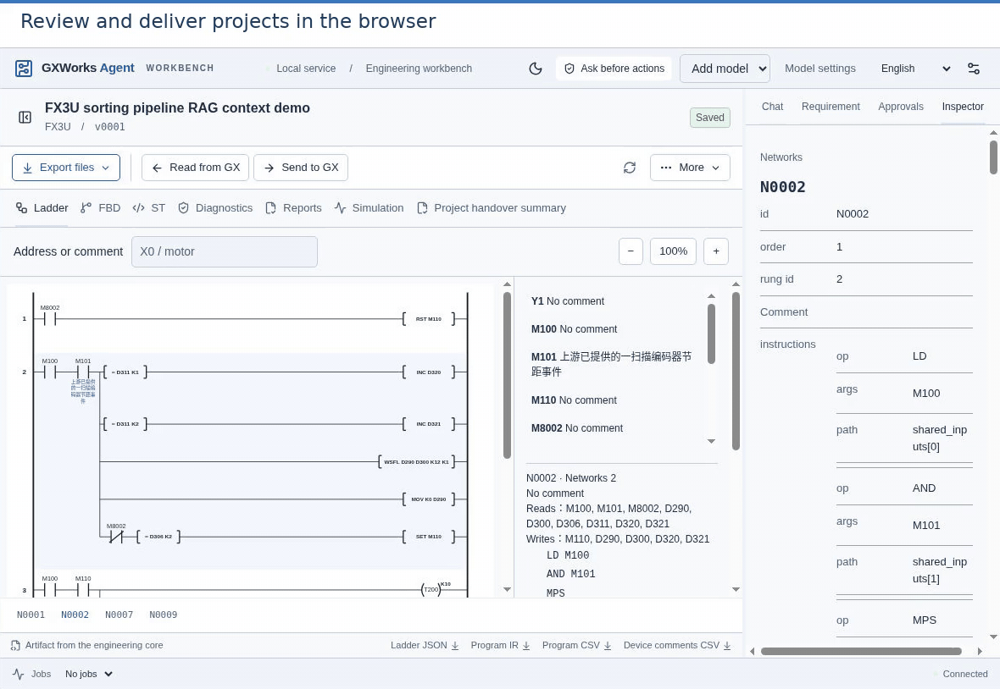

<h1 align="center">GXWorks Agent</h1>

<p align="center"><strong>Originally created by <a href="https://github.com/Arienax">Arienax</a></strong> · <a href="https://github.com/Arienax/gxworks-agent">github.com/Arienax/gxworks-agent</a></p>

<p align="center">© 2026 Arienax · Apache-2.0</p>

<h3 align="center">MCP engineering tools and an AI workbench for Mitsubishi PLC workflows.</h3>

<p align="center"><strong>Read project context · Build and review programs · Drive native GX Works2 engineering and diagnostics</strong></p>

<p align="center">
  <a href="https://github.com/Arienax/gxworks-agent/releases/latest"></a>
  <a href="#mcp"></a>
  <a href="#quick-start"></a>
  <a href="LICENSE"></a>
</p>

<p align="center"><strong><a href="https://github.com/Arienax/gxworks-agent/releases/latest">Downloads</a> · <a href="#mcp">MCP &amp; Web</a> · <a href="https://github.com/Arienax/gxworks-agent/issues">Issues</a></strong></p>

<p align="center"><a href="#quick-start">Quick start</a> · <a href="#offline-gxw">Offline GXW editing</a> · <a href="#ladder">Ladder</a> · <a href="#st">ST</a> · <a href="#fbd">FBD</a> · <a href="#native-session">Native sessions</a> · <a href="#web">Web workbench</a> · <a href="#diagnostics">Diagnostics</a></p>

<p align="center"><a href="README.zh-CN.md">简体中文</a> · <strong>English</strong> · <a href="README.ja.md">日本語</a></p>

GXWorks Agent brings together project context, CPU-scoped instruction facts, deterministic static checks, and native GX Works2 operations into a unified engineering toolchain. It supports **Ladder**, **Structured Text (ST)**, and **Function Block Diagram (FBD)** workflows, along with controlled editing and inspection for existing **SFC** projects.

Connect any MCP client—such as Codex, Claude Desktop, or Cursor—to use the engineering tools with your own model for planning, generation, live native editing, and verification, while saving versioned engineering artifacts. The standalone MCP server runs independently; the optional **Web workbench** adds browser-based Direct generation, graphical diff review, simulation testing, and operator-approved GX Works2 delivery.

<a name="offline-gxw"></a>

## Read and edit existing GXW files offline

Supported `.gxw` files can be inspected, edited, and saved without installing or starting GX Works2.

1. **Web**: Drop a `.gxw` into the main conversation or choose **Import GXW**. No Agent project needs to exist first. Inspection selects the only ordinary Program automatically; choose a target when several programs are present, or explicitly select an existing FB or FUNCTION.
2. **MCP**: Use `inspect_gxw_project` to inspect the file's CPU, sources, and format capabilities, then `import_gxw_project` to enter the shared project/version workflow.
3. Describe the change, review its preview and differences, and save a new version. Download `program.gxw` and re-import it to continue from the saved file; the original input file is preserved.

Imported Ladder sources automatically display contacts, coils, and branches, including conditions after outputs and the original `MPS/MRD/MPP` order. The source instruction list remains available.

The four languages share an offline transaction. Ladder supports source-bound instruction, float, string, and P/I label edits and moves while preserving `MPS/MRD/MPP` order and unchanged record bytes. ST edits existing Program, FB, and FUNCTION bodies and declarations, including existing interfaces, parameter order, and return types, with caller checks. FBD edits objects, connections, networks, variables, and instances of existing FB definitions. Existing SFC charts support step, transition, action, branch, merge, jump, and child-program edits with internal registrations maintained. Declaration rows may be added, removed, or reordered; actual QCD comments retain their complete text.

After import, use **Program to edit** to select another source in the same file. MCP `read_gxw_source` returns its editing model; `edit_gxw_project` submits several source, declaration, and comment edits against one current `version_id`, with differences shown per source. The new entry defaults to `save_policy="draft"`, saving an editable intermediate version with source diagnostics once file structure and storage references pass checks; `checked` rejects newly introduced recognized errors.

The FX/Q/L model catalogue participates in file capability checks, returning support scoped to CPU, format, object, and operation. Unknown records retain their original bytes while parsed objects remain editable; edits with unresolved dependencies report the specific object and reason. This workflow focuses on offline edits to existing source objects, declarations, and comments.

Modifying source or declarations marks earlier compilation results stale; run an explicit native compilation check whenever compiler verification is needed.

`validate_project(native=true)` compiles and checks an isolated copy. `compilation.acceptance=accepted` means the compiler accepted that copy. It does not write compiled artifacts back: `save.completed` and `save.exported` remain `false`, so the downloaded project may still appear pending compilation in GX Works2. The public `compile_project` tool also performs only local Core compilation. To persist native compiled artifacts, compile and save in GX Works2, or use the separate workspace API `NativeWorkspaceSourceSave.compile_project` and inspect its save and cold reopen results. Compilation, code checking, saving, and PLC execution have separate outcomes.

<a name="ladder"></a>

## Ladder: from engineering context to deliverable artifacts



In this FX3U conveyor example, the agent retrieves CPU-specific facts and manual evidence for `WSFL`, `INC`, and `T200`, constructs a Ladder candidate, and commits it through MCP. Python Core validates structure and operands, merges shared conditions, and checks maintainability. Each saved version produces Ladder JSON, PLC IR, SVG diagrams, traceable ST derived from IR, and GX Works2 import CSVs for `MAIN` and device comments. For targeted fixes on an existing version, `read_network` and `patch_program` apply scoped network patches.

The animation shows an external client constructing a candidate from the MCP context, validating it, and saving the resulting artifacts.

<a name="st"></a>

## ST: Structured Text generation and native project editing

ST workflows cover both standalone text generation and native `.gxw` project maintenance:

- **Standalone generation and review in Web**: Analyze requirements, confirm the specification, and generate `program.st` using the selected CPU's instruction context and ST call signatures. Preview candidates, inspect text diffs across versions, and save ST artifacts. Ladder versions can also export traceable ST from their PLC IR.
- **GXW ST project editing**: `read_st_project` reads existing Program, FB, and FUNCTION bodies, declarations, and ownership; `create_st_candidate` edits their bodies and declarations offline. Creating an ordinary ST Program retains the explicit resource, task, and native-operation workflow. Persistent native sessions separately support coordinated FBD editing and compilation.

The local ST checker quickly validates supported syntax and semantics and highlights constructs that need attention, working alongside GX Works2 native compilation for full compiler verification.

<a name="fbd"></a>

## FBD: from blank CPU templates to full GXW editing



Above, MCP adds fault latching, reset, and a 500 ms enable delay to the first axis of [Mitsubishi Electric's MotionControl JEC example](https://eu-assets.contentstack.com/v3/assets/blt5412ff9af9aef77f/blt9206f69c182f67c3/634ea5238602a36d8e991e63/MotionControl_JEC_a.zip). The edit preserves existing FB implementations and Axis `IN_OUT` wiring, inserts SR/TON logic, and routes the motion permit into the existing power-control block.

Beyond wiring edits on imported files, the FBD module supports end-to-end project authoring:

- **Start from templates or imported projects**: 57 CPU-specific blank FBD templates let you start a project directly by CPU model, or import an existing `.gxw` to continue editing.
- **Parameter-level and geometry-level editing**: Submit high-level `calls` and `arguments` against the schema returned by `get_fbd_catalog`—letting Core expand ports, `IN_OUT` pairs, and routing automatically—or explicitly add, modify, and remove nodes, terminals, orthogonal wires, and multiple networks.
- **Definitions, user libraries, and task registration**: Read and author project structures, ST/FBD Function Blocks, and global/local declaration tables; import user library definitions from a donor `.gxw` (`read_fbd_libraries` / `import_library`) while keeping caller programs intact; create FBs and Programs where supported by the source project; register Programs to an existing task, new task, or new resource; and configure compiler device-allocation ranges.
- **Decoupled artifacts and validation**: Every saved version produces `program.gxw`, `fbd.json`, `fbd.svg`, and a write verification report. Local readback verification, native saving, standalone compilation, and code checking run as distinct operations bound to the project version.

<a name="native-session"></a>

## Persistent native engineering sessions

With `execute_native_engineering(mode="live")`, an MCP client can drive multi-step edits inside **one continuously open GX Works2 process** across tool calls, without saving and reopening the project between every action:

- **Multi-step live authoring**: Sequentially edit global and local label tables, create or update ordinary ST Programs and ST FBs, insert FBD call instances, and rebind terminals, move nodes, or reroute wires using the active document's live node and terminal identities.
- **In-session compilation and scoped address lookup**: Compile the current source (`compile`) and query compiler-assigned addresses for global declarations, local Program variables, and `Instance.Member` paths via native cross-reference (`show_assignments`). Any subsequent source edit automatically marks earlier compilation and address results `stale`.
- **Paced execution and safe reconciliation**: Configure step dwell time (`dwell_ms`), single-step execution (`step_mode`), pause (`pause_native_engineering_session`), and resume. The session tracks active edits (`revision`), verified disk saves (`saved_revision`), and committed application versions (`version_revision`) separately. Interrupted or timed-out steps retain an `unconfirmed` receipt and reconcile against actual UI state via `rebind` before continuing.

Native engineering sessions require an interactive Windows desktop, GX Works2 `1.635.0.1`, and operator-configured execution consent.

<a name="web"></a>

## Web workbench: Direct generation, visual review, and export



Configure a model API in the workbench to use the built-in **Direct generation workflow**—analyzing requirements, confirming specifications, and generating programs—then inspect Ladder networks, FBD/SFC graphs, device usage, version diffs, and downloadable artifacts. Direct shares the same engineering context and RAG pipeline as MCP while reducing external agent orchestration overhead; workbench Q&A can still invoke read-only tools as needed.

When process facts are missing, each clarification question appears as an individual input field that preserves entered text across panel switches and reloads until submitted together. Generation uses strict structured output where supported by the endpoint and normalizes unambiguous format differences locally before Core validation.

## What the toolchain provides

- **Project-bound context and live session discovery**: Create or select versioned projects by CPU and language, or call `list_gxworks2_sessions` and `read_gxworks2_snapshot` without an Agent project to inspect a read-only snapshot of a program currently open in GX Works2. When GX Works2 is not running, `inspect_gxworks2_csv_files` takes an exported program CSV and comment CSV with an explicit CPU and returns the same kind of read-only `source_ref`.
- **CPU-scoped engineering RAG**: Retrieval combines entity matching, full-text search, and dense/LSA vector retrieval with rank fusion. Structured facts supply exact operand, step-width, and modifier rules for known instructions, while residual retrieval adds manual evidence and project-authored examples without duplicating context.
- **Deterministic Core validation and versioned artifacts**: Python Core owns PLC domain semantics—building IR, checking operands and timing, verifying FBD topology and declarations, and generating version-bound artifacts alongside native compilation, simulation, and device monitoring.
- **Controlled GX Works2 delivery**: Under operator-configured approval policies, import the current Ladder version's `MAIN` and device comments into GX Works2, or execute native FBD/ST saves, compilations, and live session steps with version-bound operation receipts.

Your client or harness owns the model and planning loop; GXWorks Agent provides the engineering context, deterministic tools, version persistence, and operation receipts.

<a name="diagnostics"></a>

## Project management, diagnostics, and simulation

| Capability | What you can do |
| --- | --- |
| Projects and versions | Create or select projects by CPU and program type (Ladder / ST / FBD / SFC), manage requirements and confirmed specifications, review candidates, compare versions, and export versioned artifacts. |
| Live GX read-only snapshots | Discover running GX Works2 windows and take a temporary read-only snapshot (`source_ref`) without creating an Agent project, then read networks and run static analysis. |
| Native compilation and source-level diagnostics | Compile and check a saved `.gxw` in an isolated workspace, query assigned addresses for declarations and FB instance members (`read_native_device_assignments`), compare saved code channels against fresh compilation (`compare_native_compiled_code`), and map diagnostics or code steps (`locate_native_code_steps`) to ST lines, declarations, FBD networks/nodes, or call instances—retaining `unresolved` when a location is ambiguous. |
| Existing SFC project editing | Read source relationships offline; edit steps, transitions, actions, branches, merges, jumps, and child programs; jointly add or remove internal objects, declarations, and registrations; preview differences and save versions. |
| Ladder simulation and live timeline viewer | Run version-bound simulation test plans with device stimuli and assertions; or use `connect_simulator` and `start_simulator_trace` to sample typed signals read-only from a connected GX Simulator2 target and inspect waveforms in the bundled Web timeline viewer (`simulator.html`). |
| Read-only PLC monitoring | With operator approval, read selected devices read-only through a configured MX Component logical station and review values and read history; permissions are bound to the project version, address range, and expiry and can be revoked at any time. |

<a name="quick-start"></a>

## Quick start

On Windows 10/11 x64, download the package you need from the [releases page](https://github.com/Arienax/gxworks-agent/releases/latest) and extract the entire ZIP. Both executable packages run standalone and require neither Python nor Node.js.

| Package | Best for | Entry point |
| --- | --- | --- |
| `GXWorks-Agent-MCP-windows-x64.zip` | Connecting an MCP client (Codex, Claude Desktop, Cursor) and using its model | `gxworks-agent-mcp.exe --local` |
| `GXWorks-Agent-Full-windows-x64.zip` | Running the Web workbench and MCP with shared runtime resources | `start-web.cmd` / `gxworks-agent-mcp.exe --local` |

The lean `MCP` package omits the Web server, model SDK, offline PDF ingestion dependencies, and demo animations, while keeping the engineering tools, RAG retrieval, engineering templates, native helpers, and the simulator timeline viewer. `Full` includes both entrypoints: its MCP server runs independently with `--local`, or connects to a running Web workbench with `--service` to share projects and review flows.

<a name="mcp"></a>

### Standalone MCP

Register a stdio server in your MCP client using the full path to `gxworks-agent-mcp.exe` as the command and `--local` as its argument. Refresh the connection, call `list_projects` to select an existing project or create one with your actual CPU and program type, use [offline GXW import](#offline-gxw) for a saved file, or call `list_gxworks2_sessions` to inspect an already-open GX Works2 window.

Try a prompt like:

> “Create an FX3U Ladder project and read the generation context and relevant instruction evidence first. Count each press of X0, turn on Y0 after 3 counts, and reset with X1. Save the candidate version and show its artifacts and any remaining diagnostics.”

External clients use their own models without starting Web. GX import and native operations follow configured execution consent; add the Web workbench whenever you want shared visual review.

**Bundled MCP router skill**: Both the source repository and the release packages include an Agent Skill under [`skills/gxworks-mcp-router/`](skills/gxworks-mcp-router) (`SKILL.md` and `references/`) covering MCP tool selection, key parameters, and call sequences for common PLC tasks—such as read-only snapshots versus versioned edits, offline `.gxw` changes versus live GX Works2 sessions, local artifact generation versus headless native compilation checks, and receipt handling across `local`, `service`, and `context` modes. Once MCP is connected, copy the `gxworks-mcp-router/` directory into your client's skills folder to enable it.

### Web workbench

Run `start-web.cmd` in the extracted `Full` directory and choose an engineering workspace folder. Create a project for a new program, or [import an existing GXW](#offline-gxw). Configure a model service under **Settings → Model → Model API** for AI generation and changes; browsing existing projects, inspecting files and graphs, and exporting artifacts require no model calls. When updating, extract the new release into a fresh directory—your separate workspace and personal settings remain intact.

### Run from source

Install Python 3.13 and Node.js 22.14 or newer, then run:

```powershell
git clone https://github.com/Arienax/gxworks-agent.git
cd gxworks-agent
.\build-web.bat --no-pause
.\start-web.cmd
```

For MCP-only source use, create `.venv-mcp`, install `requirements/mcp.txt`, and launch `gxworks-agent-mcp.cmd --local`. Node.js is not required for MCP-only source runs.

### Engineering templates and knowledge resources

Release packages include the FX3U baseline project, node and token-grammar templates, and 57 CPU-specific blank FBD projects under `gxw/templates/` (`src/gxw/templates/` in source); keep these files intact when copying or moving the application directory.

Executable packages bundle the reviewed runtime fact corpus and project-authored examples for RAG, excluding vendor manual PDFs and raw manual-text indexes. Runtime knowledge data is distributed separately from the source repository; when running from source, you can copy a release package's `knowledge/` into `resources/knowledge/` and its `resources/instructions/mitsubishi/` into the matching source directory.

Offline GXW file operations require no Mitsubishi installation. Native saving, native compilation/code checking, delivery to GX Works2, and native simulation require the corresponding Mitsubishi software installed locally; read-only PLC monitoring requires MX Component and a configured logical station. These Mitsubishi applications are not included.

The Windows native adapter loads GX Works2 components in an x86 process; the Python host can be 64 bit. A pywinauto application bitness warning alone does not establish an operation failure. Diagnose the actual foreground automation error. If screenshot capture is unavailable, the original error is retained and the capture problem is reported separately.

## Before operating machinery

Before commissioning, review all generated logic against the target CPU, field wiring, motion limits, and operating modes. Back up the target GX project before import; after sending updates to the GX Works2 project, compile, inspect, and download the program through your normal GX Works2 commissioning workflow.

Implement emergency stops, safety interlocks, and overtravel protection in an independent hardware safety system. Sanitize diagnostic records before sharing, and keep API credentials and local session URLs private.

## Guides and license

[Release changes](CHANGELOG.md) · [Issues](https://github.com/Arienax/gxworks-agent/issues)

Project-authored Core, Web, MCP, and native-adapter source code is licensed under the [Apache License 2.0](LICENSE); see the [license scope](LICENSING.md) and [third-party notices](THIRD_PARTY_NOTICES.md) for details. Contributors retain their copyright, and previously distributed releases retain their original licenses. [NOTICE](NOTICE) records the original project, author and repository for copyrighted project material.
