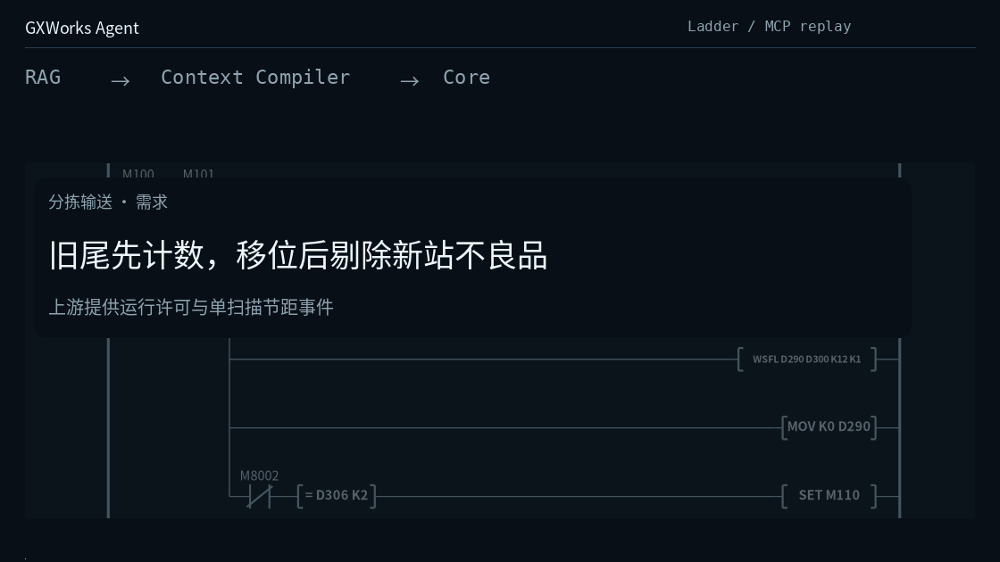
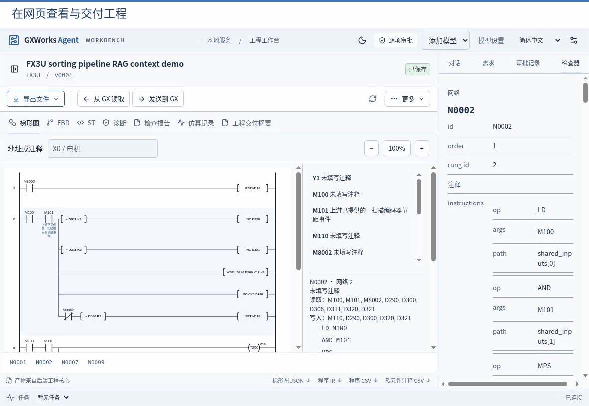
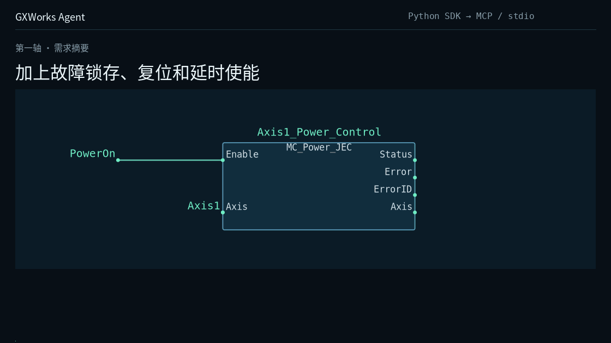

<h1 align="center">GXWorks Agent</h1>

<h3 align="center">面向三菱 PLC 工程的 MCP 工具与 AI 工作台。</h3>

<p align="center"><strong>读取工程上下文，构建与审阅程序，交付到 GX Works2。</strong></p>

<p align="center">
  <a href="https://github.com/Arienax/gxworks-agent/releases/latest"></a>
  <a href="#mcp"></a>
  <a href="#quick-start"></a>
  <a href="LICENSE"></a>
</p>

<p align="center"><strong><a href="https://github.com/Arienax/gxworks-agent/releases/latest">下载</a> · <a href="#mcp">MCP 与 Web</a> · <a href="https://github.com/Arienax/gxworks-agent/issues">问题反馈</a></strong></p>

<p align="center"><a href="#quick-start">快速上手</a> · <a href="#ladder">Ladder</a> · <a href="#st">ST</a> · <a href="#fbd">FBD</a> · <a href="#web">Web</a> · <a href="#diagnostics">诊断与验证</a></p>

<p align="center"><strong>简体中文</strong> · <a href="README.md">English</a> · <a href="README.ja.md">日本語</a></p>

GXWorks Agent 支持 Ladder、ST（结构化文本）和原生 FBD 工作流，通过 MCP 向外部 Agent 提供工程上下文、CPU 对应的指令、手册依据和工程工具。外部客户端使用自己的模型，调用工具并保存带版本的工程产物。默认 MCP 独立运行，Web 工作台可选。

<a name="ladder"></a>

## Ladder：从工程上下文到程序产物



以 FX3U 输送线片段为例：检索 `WSFL`、`INC` 和 `T200` 的工程上下文，构造梯形图候选，再通过 MCP 保存。结构化指令事实与手册证据为候选提供依据；保存结果包含 Ladder JSON、IR、SVG、由 IR 派生的 ST，以及用于 GX 导入的 CSV。

GIF 根据实际 SDK/MCP 返回结果和生成产物制作。候选由助手根据返回上下文构造，并非内置模型自主运行的录屏。

<a name="st"></a>

## ST：独立生成与审阅结构化文本

ST 在 Web 工作台有独立生成流程：分析需求、确认规格，再结合所选 CPU 的指令上下文与 ST 签名生成 `program.st`。可以预览候选、查看版本间的文本差异并保存 ST 产物。Ladder 程序也可从 PLC IR 导出可追溯的 ST。

本地 ST 检查覆盖已支持的语法与语义，并明确报告未支持的构造；这是有界解析检查，不能替代 GX Works2 编译，原生编译和 PLC 行为仍需分别确认。MCP 可提供 ST 上下文与已有诊断，当前 `create_program_candidate` 接口接收 Ladder 候选。

## API 提供什么

- **绑定工程的上下文。** 创建或选择工程，读取 CPU 和当前程序，发现适用指令与可调用接口，在已有版本上继续修改。
- **工程 RAG。** 按 CPU 提供结构化指令事实、手册片段及出处。检索架构结合实体、全文和 dense/LSA 检索，并进行排序融合；结构化事实覆盖已知指令细节，剩余检索补充相关证据。
- **候选编辑与产物。** 通过共享工程工具提交 Ladder 或 FBD 修改。Core 检查已支持的结构和操作数、准备产物，并返回对应版本的结果。本地保存、原生编译与行为验证分别记录。
- **GX Works2 交付。** 按操作员配置的执行许可，将当前 Ladder 版本的 MAIN 和软元件注释导入 GX，并返回实际操作结果。可选 Web 连接保留工作台审阅流程。

客户端或 harness 负责模型与规划循环，GXWorks Agent 提供工程上下文、工具、版本保存和操作回执。

<a name="web"></a>

## Web GUI：查看程序与导出产物



在工作台直接配置模型 API，使用内置 Direct 生成流程，再查看程序网络、软元件地址和可导出的产物。Direct 可减少外部 Agent 的编排开销，实际 token 消耗取决于模型与任务。它与 MCP 共用工程上下文处理链路；工作台问答仍可能使用多轮工具调用。

需要补充现场事实时，每个问题显示为独立输入框，必答项填写后统一提交；切换面板或重新读取结果会保留已填答案。生成时按接口能力使用严格结构化输出，并在本地处理可确定的格式差异，再执行程序检查。

<a name="fbd"></a>

## FBD：修改已有 GXW 工程



在三菱电机 MotionControl JEC 示例的第一轴中加入故障锁存、复位和 500 ms 延时使能。保留原有 FB 实现及 Axis 的 `IN_OUT` 连线，新增 SR/TON 逻辑，将使能条件接入已有功率控制块。

来源：[三菱电机 MotionControl JEC 示例](https://eu-assets.contentstack.com/v3/assets/blt5412ff9af9aef77f/blt9206f69c182f67c3/634ea5238602a36d8e991e63/MotionControl_JEC_a.zip)。

FBD 不限于演示中的连线修改：可以基于起始工程或导入的 GXW 生成、编辑候选，增删和修改对象、连线、声明及多个网络，使用当前工程与库中的 FB 接口和 `IN_OUT` 参数，并查看图形预览、版本差异和 GXW 产物。

在来源工程支持的范围内，可以新建 FB 和 Program。新建 Program 可注册到已有任务、新任务或新资源；原生保存与当前代码的编译、检查分别执行，结果关联到对应的工程版本。

<a name="diagnostics"></a>

## 工程管理、诊断与验证

| 功能 | 可以完成的工作 |
| --- | --- |
| 工程与版本 | 按 CPU 和程序类型创建、选择工程，管理需求与确认规格，审阅候选、比较版本，查看和导出各版本产物。 |
| 原生诊断 | 对与当前版本匹配的 GXW 执行原生编译、代码检查；在有对应定位信息时，将诊断关联到 ST 行、声明、FBD 网络、对象或调用实例。无法唯一定位时保留未解析状态。 |
| SFC 已有工程编辑 | 导入已有 SFC 工程，读取程序与图形，编辑已有动作、转换子程序，以及受支持的步骤动作编号、跳转目标；提供候选预览和版本差异，尚不支持从零新建完整 SFC 工程。 |
| 梯形图仿真 | 配置测试方案、软元件输入与预期结果，运行受支持的仿真后端，保存并回看运行结果，将测试与需求对应。具体指令和 CPU 支持随后端而定。 |
| PLC 只读监测 | 经操作员授权，通过已配置的 MX Component 逻辑站读取指定软元件，查看数值与读取记录。权限绑定工程版本、地址范围和有效期，可撤销；此功能不向 PLC 写入。 |

<a name="quick-start"></a>

## 快速上手

在 Windows 10/11 x64 上，从[发布页](https://github.com/Arienax/gxworks-agent/releases/latest)下载需要的组件并完整解压。两个成品包独立使用，无需安装 Python 或 Node.js。

| 发布包 | 使用方式 | 启动入口 |
| --- | --- | --- |
| `GXWorks-Agent-MCP-windows-x64.zip` | 接入 Codex 等 MCP 客户端，使用客户端的模型 | `gxworks-agent-mcp.exe --local` |
| `GXWorks-Agent-Web-windows-x64.zip` | 通过浏览器生成、编辑和管理工程 | `start-web.cmd` |

<a name="mcp"></a>

### 独立 MCP

在客户端添加 stdio 服务：命令为解压目录中 `gxworks-agent-mcp.exe` 的完整路径，参数为 `--local`。刷新客户端连接，先调用 `list_projects`，再选择已有工程，或明确实际 CPU 和程序类型创建工程。

可以从这样的任务开始：“新建 FX3U Ladder 工程，先读取生成上下文和相关指令依据。实现 X0 每次按下计数一次，满 3 次点亮 Y0，X1 复位。保存候选，列出产物和待处理的诊断。”

外部客户端使用自己的模型，无需启动 Web。GX 导入按已配置的执行许可进行；需要共用工程与审阅流程时，可选用 Web 工作台。

### Web 工作台

运行解压目录中的 `start-web.cmd`，按提示选择工程工作区。在工作台新建工程，在“设置 → 模型 → 模型 API”中配置模型服务后即可生成程序。查看已有工程无需调用模型。更新时将新包解压到新目录，保留独立保存的工程工作区和个人设置。

### 从源码运行

安装 Python 3.13 和 Node.js 22.14 或更新版本，然后运行：

```powershell
git clone https://github.com/Arienax/gxworks-agent.git
cd gxworks-agent
.\build-web.bat --no-pause
.\start-web.cmd
```

只用源码 MCP 时，创建 `.venv-mcp` 并安装 `requirements/mcp.txt`，使用 `gxworks-agent-mcp.cmd --local` 入口，无需 Node.js。

### 工程模板与知识资源

成品包的 `gxw/templates/` 包含 FX3U 基线、节点与语法模板，以及 57 个按 CPU 区分的空白 FBD 工程；源码中的位置为 `src/gxw/templates/`。复制应用时应保留这些文件。模板可用不等于该型号已通过原生编译或 PLC 运行验证。

成品包包含经整理的运行事实库和项目原创案例，供 RAG 使用，不包含三菱原始手册和原文索引。生成的运行数据与源码仓库分开提供；源码用户可将成品包的 `knowledge/` 复制到 `resources/knowledge/`，并将包内 `resources/instructions/mitsubishi/` 复制到源码同名目录。

原生保存、代码检查、GX 导入和仿真需要本机安装相应的三菱软件；PLC 只读监测需要 MX Component 及逻辑站配置。发布包不包含这些三菱软件。

## 当前范围

- GX 集成需要 Windows，桌面发送需要可交互的 Windows 会话。
- 原生 FBD 集成绑定 GX Works2 **1.635.0.1**；梯形图与 ST 的生成、编辑和导出不受该版本限制。支持的 Q／L／FX CPU 菜单提供对应空白 FBD 起始工程，导入工程沿用其 CPU 和接口。FX1 当前不在 FBD 生成支持范围；模板可用性与原生编译验收分别记录。
- CPU 出现在菜单中，不代表其指令与验证覆盖完全一致。缺少验证配置时返回未验证状态。
- FBD 支持对象、连线、声明、多网络和基于来源工程的 FB/Program 创建。SFC 支持已有动作、转换子程序编辑，Web 面板可修改受支持的步骤动作编号和跳转目标并查看候选，尚不是完整图形 IDE。
- 产物保存或导入成功，不等于编译通过或 PLC 行为正确。

## 设备投运前

按所选 CPU、实际接线、运动边界和运行模式审查生成逻辑。导入前备份目标 GX 工程，在目标 GX Works2 环境编译、检查后再调试设备。发送到 GX Works2 **不等于向 PLC 下装程序**。

急停、防护等安全功能应由独立安全系统承担，生成的应用逻辑和软件检查不能替代这些功能。公开诊断记录前请先脱敏，不要分享凭据或本机会话链接。

## 资料与许可

[版本改动](CHANGELOG.md) · [贡献指南](CONTRIBUTING.md) · [问题反馈](https://github.com/Arienax/gxworks-agent/issues) · [安全政策](SECURITY.md)

项目贡献者拥有权利的 Core、Web、MCP 和原生适配器源码采用 [Apache License 2.0](LICENSE)，具体范围见[许可范围](LICENSE-SCOPE.md)和[第三方声明](THIRD_PARTY_NOTICES.md)。贡献者保留各自版权。已有发布版本仍适用其发布时的许可。
