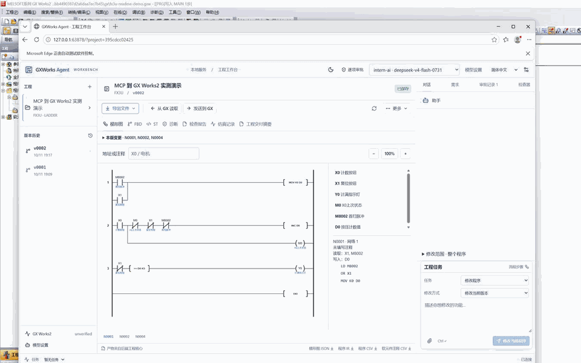

# GXWorks Agent

简体中文 | [English](README.md)

**让 AI Agent 在真实 PLC 工程中工作。** GXWorks Agent 通过 MCP 将当前工程、CPU、可用指令和手册知识交给外部 Agent；它检查生成的梯形图，并在工程师确认后把当前版本的 MAIN 和软元件注释发送到 GX Works2。需求、程序版本和交付结果留在同一个本地工作台，减少在聊天、手册、文件和 GX Works2 之间反复搬运的操作。



**FX3U 演示：** X0 每按下一次计数，满 3 次点亮 Y0，X1 复位。Codex CLI Agent 通过 MCP 读取工程、发现相关能力、检索手册知识并提交梯形图候选；白蓝配色网页展示审阅后版本的审批，GX Works2 展示导入的 MAIN 和简短软元件注释。这里展示的是 MCP 与 Web 可选连接的流程。GIF 来自真实桌面录屏，仅剪去等待片段。CSV 由应用生成作为交付格式，工程师无需手工转换、重复录入程序和注释。

## 从需求到 GX Works2

1. **Agent 直接操作工程。** Codex 等 MCP 客户端可以创建或选择工程、读取程序和生成上下文，再由独立 MCP 保存通过检查的候选。后续修改沿用工程和版本信息，Web 工作台作为可选界面。
2. **模型拿到与任务相关的工程知识。** 能力发现按需求寻找适用指令和工程接口；RAG 汇集所选 CPU 的指令定义、手册证据、可调用对象及构造示例，交给外部 Agent 使用。应用对候选的地址、指令参数和梯形图结构做检查，并给出可查看的结果。
3. **授权后送入 GX。** 外部 Agent 按工程师配置的执行许可请求交付当前梯形图版本；独立 MCP 直接返回原生回执，可选 Web 连接保留工作台审阅。应用将 MAIN 和软元件注释导入 GX Works2 工程并保存。对于支持的 GX 版本和 CPU，无 GX 窗口时自动启动，没有打开工程时新建独立工程。接着在 GX Works2 中编译、检查结果。

工作台还提供程序版本对比、局部修改、工程问答和交付产物查看。Structured Ladder/FBD 有独立的 GXW 读写、候选编辑和原生检查路径。

## 快速上手

在 Windows 10/11 x64 上，从[发布页](https://github.com/Arienax/gxworks-agent/releases/latest)选择需要的组件。两个包独立安装，无需安装 Python。

| 组件 | 适合的使用方式 | 安装要求 |
| --- | --- | --- |
| GXWorks-Agent-MCP-windows-x64.zip | 在 Codex 等 MCP 客户端中操作工程，使用客户端自己的模型 | 不需要 Web 或 Node.js |
| GXWorks-Agent-Web-windows-x64.zip | 浏览器工作台，管理工程、配置模型、编辑程序和查看诊断 | Node.js 22.14 或更新版本，不需要 MCP |

### Web 工作台

完整解压 Web 包，在解压目录内运行：

```sh
npm install
npm run build
npm start
```

也可以克隆本仓库后运行同样的命令；首次启动会自动下载匹配版本的运行组件。启动后自动打开浏览器，工程默认保存在 `%LOCALAPPDATA%\GXWorks Agent\web-workspace`，无需选择工作区。

在工作台新建工程，在“设置 → 模型 → 模型 API”中配置自己的模型服务，即可使用模型生成功能。查看和管理已有工程不需要调用模型。更新时将新包解压到新目录，原有工程和个人设置继续保留。

### 独立 MCP

完整解压 MCP 包，在客户端添加 stdio 服务：命令为解压目录中的 `gxworks-agent-mcp.exe`，参数为 `--local`。刷新客户端连接后，就可以给 Agent 这样的任务：

> 请先读取当前 FX3U 工程和生成上下文，查找计数与上升沿相关的可用能力和手册依据。实现 X0 每次按下计数一次、计满 3 次点亮 Y0、X1 复位；提交梯形图候选供我确认，再请求发送当前版本到 GX Works2。

外部 MCP 客户端使用自己的模型，无需启动 Web。首次使用时先调用 `list_projects`，再选择工程或指定实际 PLC 型号和目标语言创建工程。需要共用 Web 工程与审批时，按[组件与可选连接](docs/private-component.md)配置 `--service` 模式。

原生保存、代码检查、导入和仿真需要本机安装相应的三菱软件；发布包不包含 GX Works2 或 MX Component。可用操作取决于 CPU、工程类型及软件版本。

## 更多信息

[组件与可选连接](docs/private-component.md)介绍独立运行和连接设置。[贡献指南](CONTRIBUTING.md)、[问题反馈](https://github.com/Arienax/gxworks-agent/issues)和[安全政策](SECURITY.md)提供参与与反馈入口。

界面开发在仓库根目录运行 `npm test` 和 `npm run build`；`npm start` 加载当前的 `web/dist`。需要提前下载运行组件时使用 `npm run setup`，离线安装使用 `npm run setup -- --archive <Web发布包.zip>`。

## 设备投运前

按所选 CPU、实际接线、运动边界和运行模式审查生成逻辑，在目标 GX Works2 环境编译、检查后再调试设备。急停、防护等安全功能应由设备的独立安全系统承担，生成的应用逻辑和软件测试不能替代这些功能。

## 许可

本项目采用源码可见的专有[许可证](LICENSE)。许可范围内的副本须保留许可证原文及[第三方归属声明](THIRD_PARTY_NOTICES.md)。
